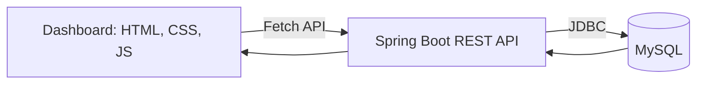

<div align="center">


<h1>Raja Nandhana M</h1>

<h3>☕ Java Developer &nbsp;|&nbsp; 🌱 Spring Boot &nbsp;|&nbsp; 🗄️ MySQL &nbsp;|&nbsp; 🔌 REST APIs</h3>


<br/>


<br/><br/>

<a href="mailto:rajanandhanamarimuthu@gmail.com"></a>
<a href="https://www.linkedin.com/in/raja-nandhana-m-814a0a389"></a>
<a href="https://github.com/YOUR_USERNAME?tab=repositories"></a>

<br/><br/>


</div>


## 👨‍💻 About Me

<table>
<tr>
<td width="55%" valign="top">

I'm a **Computer Science and Engineering student** with a strong foundation in **Java, Data Structures and OOP**. I enjoy building full stack web apps with **Spring Boot, MySQL and REST APIs**.

- 🎓 **B.E. CSE**, VSB Engineering College (2028), CGPA **8.0**
- 🏢 Completed the **Pega National Internship Program**
- 💻 Built a **College Attendance Management System**
- ⚡ Quick learner with strong **problem-solving and teamwork**
- 🎯 Seeking a **software development** opportunity

</td>
<td width="45%" valign="top">

```java
public class RajaNandhana {
  String role  = "CSE Student";
  String stack = "Java + Spring Boot";
  String db    = "MySQL";
  String goal  = "Software Developer";

  void code() {
    while (alive) {
      learn(); build(); improve();
    }
  }
}
```

</td>
</tr>
</table>


## 🛠️ Tech Stack

<div align="center">


<br/><br/>


</div>


## 🚀 Featured Projects

### 🎓 [College Attendance Management System](https://github.com/YOUR_USERNAME?tab=repositories)

A web portal for professors and departments to manage daily student attendance.

- 🗄️ Loads the master student list, roll numbers and departments dynamically from **MySQL**
- 🔁 Uses SQL `ON DUPLICATE KEY UPDATE` so records update automatically when a teacher changes a selection
- 🔌 **RESTful API** layer separates backend processing from the web interface
- 📱 Responsive, clean dashboard for easy tracking



      

<table>
<tr>
<td width="50%" valign="top">

### 🎯 [Gamified Goal Achievement System](https://github.com/YOUR_USERNAME?tab=repositories)
**AI-powered Java application**

- 🏆 Track goals, earn rewards, monitor progress
- 💡 Recommendations to boost productivity


</td>
<td width="50%" valign="top">

### ❌⭕ [Tic-Tac-Toe Game](https://github.com/YOUR_USERNAME?tab=repositories)
**Python game with complete logic**

- 🎮 Player interaction and winner detection
- 🔧 Published on GitHub with version control

 

</td>
</tr>
</table>


## 🧭 Learning Journey

| When | Milestone |
|:---|:---|
| 🎓 **2024** | Started B.E. Computer Science and Engineering at VSB Engineering College |
| 🐍 **Jul 2025** | Python Foundation Certification, Infosys Springboard |
| 🌐 **Dec 2025** | Introduction to IoT and Digital Transformation, Cisco Networking Academy |
| ☕ **Jun - Oct 2026** | Programming in Java, NPTEL |
| ☕ **Jul 2026** | Java Foundation Certification, Infosys Springboard |
| 🏢 **Aug - Sep 2026** | Pega National Internship Program (60 hours) with Pegasystems and SmartBridge |
| 🚀 **2028** | Expected graduation |

### 🏢 Internship Highlights

- **Pegasystems Worldwide India Pvt. Ltd.** (with SmartBridge), `4 Aug 2026 - 3 Sep 2026`
- Industry-integrated learning in **workflow automation** and **low-code technologies**
- Hands-on **real-world project implementation**

## 📜 Certifications

<div align="center">


<br/>


<br/><br/>


</div>


## 📊 GitHub Stats

<div align="center">


<br/>


<br/><br/>


<br/><br/>


</div>


## 🎯 Currently Focused On

- [x] Build full stack projects with Spring Boot and MySQL
- [x] Complete the Pega National Internship Program
- [x] Earn Java and Python certifications
- [ ] Master Data Structures and Algorithms
- [ ] Build more REST API projects
- [ ] Contribute to open source
- [ ] Land a software development internship or role 🚀

## 🌐 Let's Connect

<div align="center">

<a href="mailto:rajanandhanamarimuthu@gmail.com"></a>
<br/>
<a href="https://www.linkedin.com/in/raja-nandhana-m-814a0a389"></a>
<a href="https://github.com/YOUR_USERNAME"></a>

<br/><br/>


</div>
